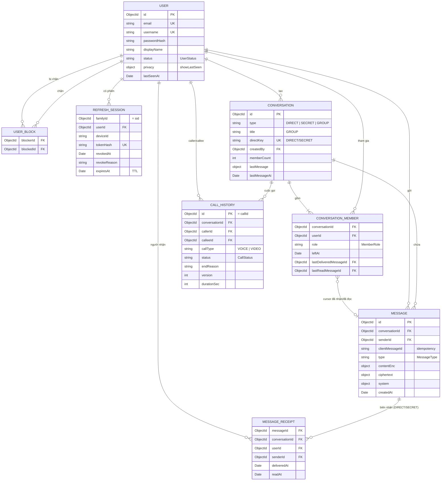
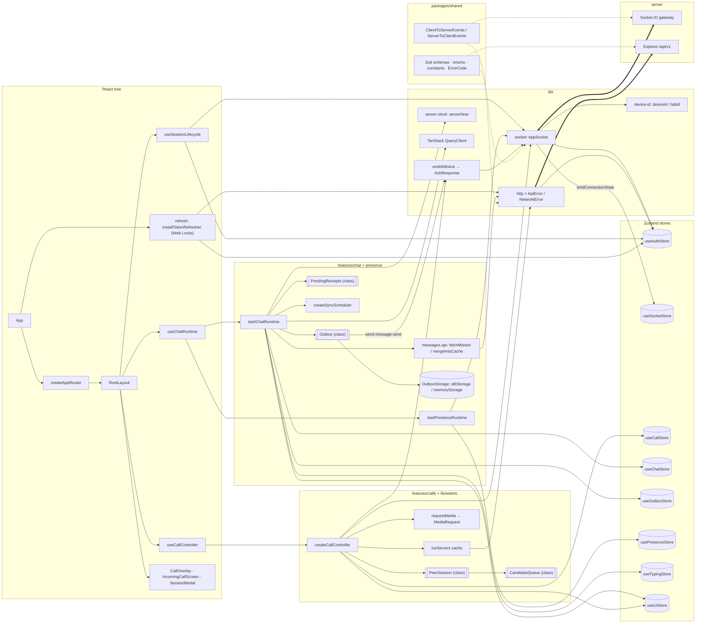

# HUSTALO — Sơ đồ quan hệ các đối tượng chính

Sinh từ mã nguồn (CodeGraph) ngày 2026-11-03. Điểm ghép nối: `createRuntime` (`server/src/main.ts`) phía server,
`RootLayout` (`client/src/routes/router.tsx`) phía client. Nguồn sự thật vẫn là `.spec/`; khi mã đổi, cập nhật lại sơ đồ.

## 1. Server — tầng vào, service, repository

```mermaid
classDiagram
  direction LR

  namespace Bootstrap {
    class Runtime {
      +httpServer
      +io HustaloServer
      +emitter Emitter
      +setDraining(v)
      +close()
    }
    class ExpressApp {
      +createApp(AppDeps)
      +apiRouter(RouterDeps)
    }
  }

  namespace Realtime {
    class HustaloServer {
      +createGateway(httpServer, GatewayOptions)
      +socketAuth middleware
      +adapter memory | redis-streams
    }
    class Emitter {
      +toUser() toDevice() toTab() toSession()
      +toConv() toPresence() toUserExceptTab()
      +toUserFirstAck(timeoutMs) Promise~boolean~
      +disconnect() leaveRoom() socketsIn()
    }
    class SocketRevocationChecker {
      +isSessionRevoked(sid) Promise~boolean~
    }
    class SocketHandlers {
      +registerPresenceHandlers()
      +registerTypingHandlers()
      +registerConversationHandlers()
      +registerMessageHandlers()
      +registerCallHandlers()
    }
    class SessionNotifier {
      +sessionRevoked(sid, reason)
      +subscribeUserLocked()
    }
  }

  namespace AuthModule {
    class AuthService {
      +register() login() refresh() logout()
    }
    class AuthRepository
    class CallTerminator {
      +endCallsForSession(sid, cause)
    }
  }

  namespace UsersModule {
    class UsersService {
      +getMe() search() block() isBlockedEitherWay()
    }
    class UsersRepository
  }

  namespace ConversationsModule {
    class ConversationsService {
      +assertMember() getOtherMember() createGroup()
    }
    class ConversationsRepository
  }

  namespace MessagesModule {
    class MessagesService {
      +send() edit() recall() page()
    }
    class MessagesCore {
      +createSystemMessage()
    }
    class ReceiptsService {
      +delivered() read()
    }
    class MessagesRepository
  }

  namespace CallsModule {
    class CallsService {
      +invite() accept() reject() cancel() hangup()
      +endCallsForSession() endCallsForUser()
      +start() stop()
    }
    class CallStateMachine {
      +transition(state, event, actor)
      +deadlineOps()
    }
    class CallSweeper
    class CallStateRepository
    class CallsRepository
    class IceServersService
  }

  namespace PresenceModule {
    class PresenceService
    class TypingService
    class PresenceRepository
  }

  class RateLimiters

  <<interface>> Emitter
  <<interface>> SocketRevocationChecker
  <<interface>> CallTerminator
  <<Mongo>> UsersRepository
  <<Mongo>> ConversationsRepository
  <<Mongo>> MessagesRepository
  <<Mongo>> CallsRepository
  <<Mongo+Redis>> AuthRepository
  <<Redis>> CallStateRepository
  <<Redis>> PresenceRepository
  <<Redis>> RateLimiters

  %% Composition root
  Runtime *-- HustaloServer
  Runtime *-- Emitter
  Runtime *-- ExpressApp
  Runtime *-- SocketHandlers

  %% Realtime
  Emitter --> HustaloServer : io.to(room).emit
  HustaloServer ..> SocketRevocationChecker : socketAuth
  AuthRepository ..|> SocketRevocationChecker : isRevoked(sid)
  SocketHandlers --> HustaloServer : io.on connection
  SocketHandlers --> RateLimiters
  SocketHandlers --> PresenceService
  SocketHandlers --> TypingService
  SocketHandlers --> ConversationsService
  SocketHandlers --> MessagesService
  SocketHandlers --> ReceiptsService
  SocketHandlers --> CallsService
  SessionNotifier --> Emitter

  %% HTTP /api/v1
  ExpressApp --> AuthService
  ExpressApp --> UsersService
  ExpressApp --> ConversationsService
  ExpressApp --> MessagesService
  ExpressApp --> ReceiptsService
  ExpressApp --> CallsService
  ExpressApp --> IceServersService
  ExpressApp --> RateLimiters

  %% Auth
  AuthService --> AuthRepository
  AuthService --> SessionNotifier
  AuthService --> UsersService
  AuthService --> CallTerminator : late binding
  CallsService ..|> CallTerminator

  %% Users / Conversations / Messages
  UsersService --> UsersRepository
  ConversationsService --> ConversationsRepository
  ConversationsService --> UsersService
  ConversationsService --> MessagesCore : system message
  ConversationsService --> Emitter
  MessagesService --> MessagesRepository
  MessagesService --> ConversationsService : ConversationsPort
  MessagesService --> UsersService
  MessagesService --> Emitter
  MessagesCore --> MessagesRepository
  ReceiptsService --> MessagesRepository
  ReceiptsService --> MessagesCore
  ReceiptsService --> ConversationsService
  ReceiptsService --> Emitter

  %% Calls
  CallsService --> CallStateMachine
  CallsService *-- CallSweeper
  CallsService --> CallStateRepository : Lua CAS
  CallsService --> CallsRepository : callHistory
  CallsService --> ConversationsService
  CallsService --> UsersService
  CallsService --> MessagesService : CALL system msg
  CallsService --> Emitter
  CallsService --> RateLimiters : limitInvite

  %% Presence
  PresenceService --> PresenceRepository
  PresenceService --> UsersService
  PresenceService --> ConversationsService
  PresenceService --> Emitter
  TypingService --> PresenceRepository
  TypingService --> ConversationsService
  TypingService --> UsersService
  TypingService --> Emitter
```

## 2. Mô hình dữ liệu MongoDB (Mongoose models)



Trạng thái nằm ở Redis (không có trong sơ đồ này): cuộc gọi đang diễn ra (`CallActiveState`), presence/typing,
rate limit, đánh dấu phiên bị thu hồi.

## 3. Client — runtime, lib, store



## Ghi chú kiến trúc

- `Emitter` là cổng ra realtime duy nhất; service nhận nó qua `deps` thay vì phụ thuộc Socket.IO trực tiếp
  (mock được trong unit test).
- Vòng `AuthService` ↔ `CallsService` được phá bằng interface `CallTerminator` gắn trễ trong `createRuntime`.
- Vòng conversations ↔ messages được phá bằng `MessagesCore` (conversations → messages) và `ConversationsPort`
  (messages → conversations).
- `CallsService` có nhiều phụ thuộc nhất: 6 service/repository, cộng state machine và sweeper.
- Client không giữ socket/token trong component: `socket` và `http` đọc token từ `useAuthStore`; các runtime chat/call
  bật/tắt theo `meId` trong `RootLayout`.
